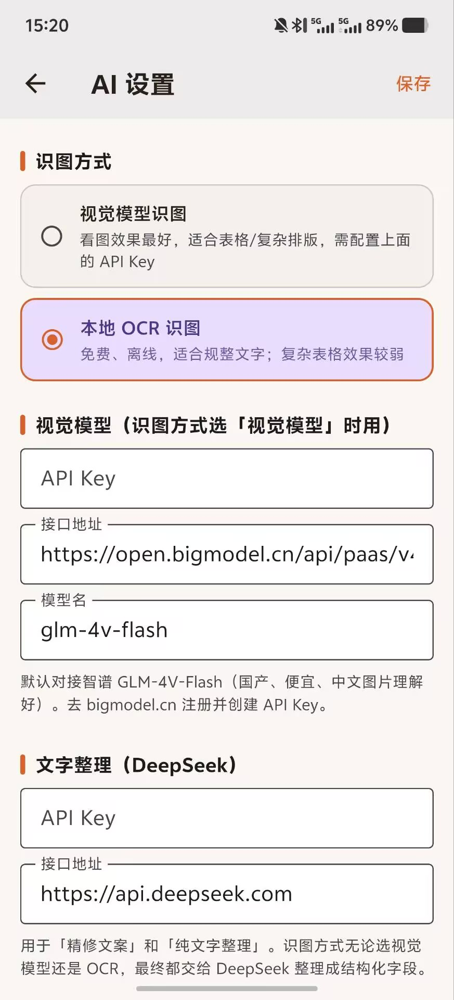
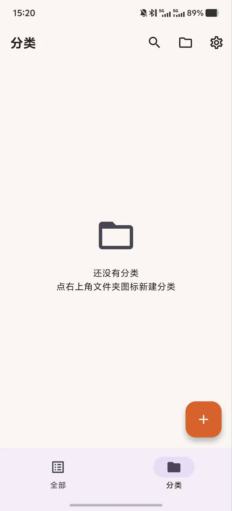
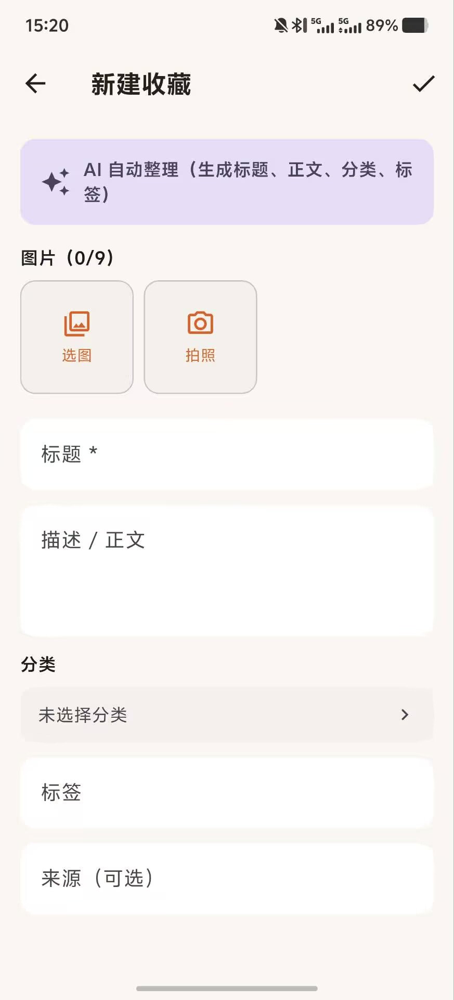
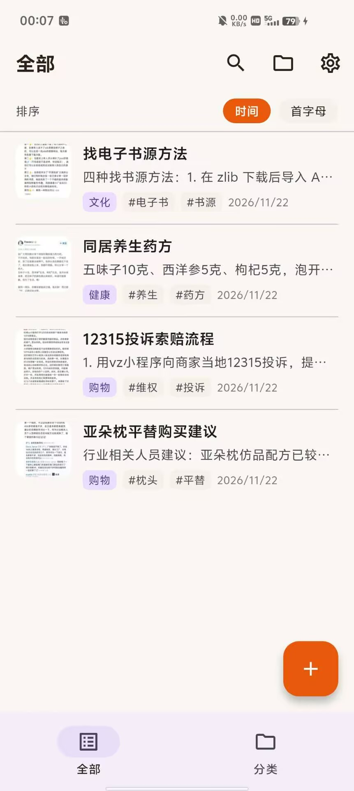

# 存知

记录、收纳、整理你的生活干货。

[](https://github.com/DDwillow/cunzhi-app/releases/download/v1.0.0/cunzhi-v1.0.0-release.apk)

**逛社区的时候，总习惯随手截图保存大家分享的东西**——怎么买东西便宜、哪个东西好用、哪家店好吃……可截图堆在相册里，和密密麻麻的照片混在一起，既不好翻也不好找，有时候找到了，也忘了当时存它是要干嘛。

「存知」就是为这个场景做的一个收藏整理分类工具：把那些零散的截图和照片，变成**有标题、有分类、有标签、随时搜得到**的个人知识库。借 AI 帮你自动整理，让收藏真正「存得住、找得到、用得上」。

## 核心功能

- **手动录入**：拍照 / 选图（最多 9 张）+ 标题 + 描述 + 分类 + 标签 + 来源
- **AI 自动整理**：添加自己的 API Key 后，上传图片一键让 DeepSeek 归纳整理，自动生成标题、正文、分类、标签，并自动匹配已有分类或新建分类
- **识图双通道**：
  - 本地 OCR（ML Kit，免费离线）提取文字 → DeepSeek 整理（默认方式，无需额外配置）
  - 视觉模型直接看图 → DeepSeek 整理（对有视觉处理能力的 AI 效果更好，需自填视觉模型 Key）
- **文档式首页**：标题列表（可按时间 / 首字母排序）+ 分类 Tab 浏览
- **分类管理**：完全自由建分类，支持无限层级（父类 / 子类 / 子子类…）
- **浏览检索**：按分类浏览 + 关键词搜索（标题 / 描述 / 标签 / 来源）
- **编辑管理**：随时修改、删除、移动分类
- **本地存储**：数据完全本地，SQLite 存数据 + 应用私有目录存图片，离线可用

## 界面预览

| 首页 | 分类 | 新建收藏 |
|------|------|----------|
|  |  |  |

| AI 设置 |
|---------|
|  |

## 技术栈

- Flutter（Dart 3）
- sqflite（本地 SQLite 数据库）
- image_picker（拍照 / 相册选图）
- path_provider（应用私有目录）
- provider（状态管理）
- http（AI 接口调用）
- shared_preferences（本地存 API Key）
- google_mlkit_text_recognition（本地 OCR 中文识别）

## 项目结构

```
cunzhi/
├── lib/
│   ├── main.dart                     # 入口
│   ├── theme.dart                    # 主题（暖橙色调，支持深色模式）
│   ├── models/
│   │   ├── category.dart             # 分类模型（支持父子层级）
│   │   └── record.dart               # 记录模型（多图 + 标签 + 来源）
│   ├── data/
│   │   ├── database_helper.dart      # SQLite 数据库封装
│   │   └── app_state.dart            # 状态管理（Provider，分类匹配/自动建分类）
│   ├── services/
│   │   ├── ai_service.dart           # AI 服务（DeepSeek，识图方式分派）
│   │   ├── ocr_service.dart          # 本地 OCR（ML Kit 中文模型）
│   │   └── image_storage.dart        # 图片私有目录存储
│   └── screens/
│       ├── home_screen.dart          # 主页（文档式列表 + 分类 Tab + 搜索）
│       ├── edit_screen.dart          # 录入 / 编辑页（含 AI 自动整理）
│       ├── detail_screen.dart        # 详情页
│       ├── category_manage_screen.dart  # 分类管理页
│       └── settings_screen.dart      # 设置页（AI Key 配置）
└── android/                          # Android 平台配置
```

## 环境要求

- Flutter SDK（3.x，Dart >= 3.0）
- Android SDK（compileSdk 34）
- JDK 17

## 运行

```bash
# 1. 安装依赖
cd cunzhi
flutter pub get

# 2. 运行（连接手机或模拟器）
flutter run

# 3. 打包 APK（release，仅 arm64-v8a 架构，约 48MB）
flutter build apk --release --target-platform android-arm64
```

> 说明：当前工程已含 Android 平台配置。若需 iOS 版本，在 macOS 上执行
> `flutter create --platforms=ios .` 会自动补全 iOS 目录。

## 使用 AI 功能

AI 功能需要自备 API Key（不内置、不收集任何密钥）：

1. 打开 App → 设置页
2. 填入 DeepSeek API Key（用于文字整理）
3. 选择识图方式：
   - **本地 OCR**：免费离线，无需额外 Key
   - **视觉模型**：需再填一个视觉模型 Key（如智谱 GLM-4V）

所有 Key 仅保存在手机本地（shared_preferences），不会上传到任何服务器。

## 数据说明

- 数据存于应用私有目录的 SQLite 数据库（`cunzhi.db`）。
- 图片存于应用私有目录 `images/` 下，完全离线。
- 卸载应用会清除数据，如需保留请先自行备份。

## 版本记录

详见 [CHANGELOG.md](CHANGELOG.md)。

## 后续规划

- [ ] JSON 导出 / 导入备份（含图片打包，防换机丢失）
- [ ] 分类拖拽排序
- [ ] 云同步
- [ ] iOS 版本

## License

[MIT](LICENSE)
